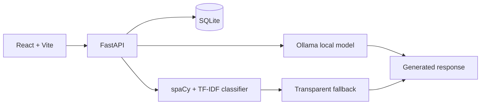

# ConversaAI

ConversaAI is a local-first, portfolio-ready conversational assistant that combines a React interface, FastAPI, SQLite, transparent NLP diagnostics, and an optional local Ollama language model. It works in reduced-capability fallback mode without Ollama—there is no fake claim that an unavailable model produced an answer.

## What it demonstrates

- Multi-conversation chat history, isolated by a browser-session identifier
- spaCy tokenization, lemmatization, stopword-aware content analysis, and named-entity recognition
- A reproducible TF-IDF + Logistic Regression intent classifier with real probability confidence
- Semantic similarity against training examples and confidence-gated fallback answers
- Optional Ollama chat generation with bounded history, timeout handling, and prompt-injection safeguards
- Responsive dark/light UI, developer NLP panel, copy and regenerate controls

## Architecture



## Run on macOS (Apple Silicon)

Requirements: Python 3.11+ (3.13 is supported by the declared ranges), Node.js 20+, and optionally [Ollama](https://ollama.com).

```bash
cd "/Users/sonalikaur/Documents/ChatGPT/nlp ai"
python3 -m venv .venv
source .venv/bin/activate
pip install -r backend/requirements.txt
python -m spacy download en_core_web_sm
cd backend
cp .env.example .env
python train_model.py
uvicorn app.main:app --reload --port 8000
```

In a second terminal:

```bash
cd "/Users/sonalikaur/Documents/ChatGPT/nlp ai/frontend"
npm install
npm run dev
```

Open **http://localhost:5173**. Interactive API docs are at **http://localhost:8000/docs**.

### Optional local model

Install Ollama using its macOS installer, then run:

```bash
ollama pull qwen2.5:3b
ollama serve
```

`qwen2.5:3b` is a lightweight multilingual model (about 1.9 GB) suitable for an M3 MacBook Air. It is configured to answer in the same language as the user message. Adjust `OLLAMA_MODEL`, `OLLAMA_BASE_URL`, and `AI_RESPONSE_TIMEOUT` in `backend/.env` if needed. If it is not running, ConversaAI does not invent an answer—it reports that the generative model is unavailable.

### Optional local semantic embeddings

`sentence-transformers` is included for semantic similarity. Cache its compact model once while online:

```bash
source .venv/bin/activate
python -c "from sentence_transformers import SentenceTransformer; SentenceTransformer('all-MiniLM-L6-v2')"
```

Requests never fetch an embedding model at runtime. Until this model is cached, ConversaAI uses its deterministic TF-IDF semantic-similarity fallback.

## API

- `GET /api/health`
- `POST /api/chat`
- `GET|POST /api/conversations`
- `GET|DELETE /api/conversations/{id}`
- `GET /api/conversations/{id}/messages`
- `GET /api/nlp/analyze?text=...`

All conversation endpoints require `session_id`; the frontend creates and stores it in browser session storage. This is suitable for local demos only. Use authenticated users and authorization before deploying publicly.

## Retraining and tests

```bash
cd backend
python train_model.py
cd ..
PYTHONPATH=backend pytest -q
```

The training script prints a real held-out classification report. With the intentionally compact, 90-example training set, its held-out scores are not a reliable production quality estimate; expand the dataset before making accuracy claims.

## Limitations and future work

Fallback responses are intentionally limited to the dataset’s supported intents; open-ended factual responses require a running local model. The current demo has no user accounts, rate limiting, streaming, or vector database. Good next enhancements are authentication, broader evaluation data, streamed Ollama output, and retrieval over user-provided documents.
